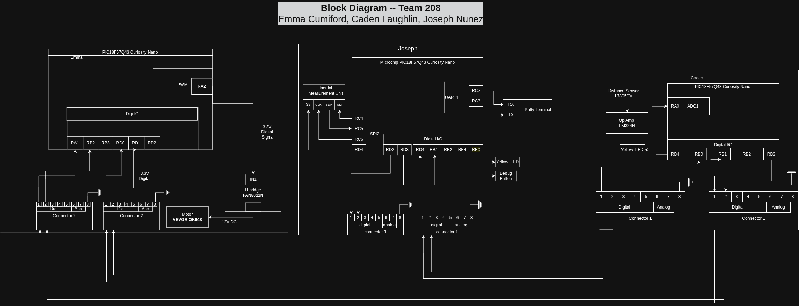

## Introduction

**Bold Text**
_Italic Text_
**_Bold and Italic Text_**

## Team Block Diagram, Process Diagram, and Message Structure
[Team_Block_Diagram](https://app.diagrams.net/#G1Mv4OLmAqWyhrVXr4TWVB89evNlQIgr9X#%7B%22pageId%22%3A%22DuODgdJueQHADXTg6JkB%22%7D)

The three boards of our block diagram consist of Joseph's Inertial Measurment and Display Board, Caden's Distance Sensor Board, and Emma's Motor Actuation Board. Since Joseph's board outputs a motor direction based on the comparison between his own board's direction and Caden's output direction, there was, originally, a simple daisy chain connection between the three board. But, after considering the failure of Joseph's board, another connection between Caden and Emma's board was made to ensure the motor would receive directional data even if a board failed.
